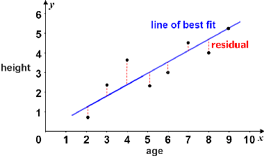

```{r setup, include=FALSE}
knitr::opts_chunk$set(echo = FALSE, message = FALSE, warning = FALSE)
library(ggplot2)

# lets a chunk shrink its output text via size="scriptsize"
knitr::knit_hooks$set(size = function(before, options, envir) {
  if (before) paste0("\\", options$size, "\n\n") else "\\normalsize\n\n"
})

qr_image <- "images/adobe-express-qr-code.png"

# DATA NEEDED: put the lecture files in a data/ folder (see note at top).
marriage_path  <- "data/broockman_skovron.csv"
democrats_path <- "data/ps3-house-election-spending.csv"

has_marriage  <- file.exists(marriage_path)
has_democrats <- file.exists(democrats_path)
```


## Agenda

1. Bivariate Regression
2. Multiple Linear Regression

## Reminders

- Problem Set 3 due **Today by 11:59 pm**
- First Draft of Report due 11/13
   - Make sure you know how to load data in the jupyter notebook so you can ask for help if you need it

## Recall: Bivariate Linear Regression

<!-- DATA NEEDED: lecture dataset with marriage_opinion and marriage_perception
     -> save as data/marriage.csv. Falls back to the original screenshot until then. -->

::::: {.columns align=center}
:::: {.column width="60%"}
- We can explain relationships through the form:

`predicted_y = slope * x + intercept`

\pause

- Useful code:

```{r, echo=TRUE, eval=FALSE}
qplot(x, y, data) +
  geom_smooth(method = 'lm')

summary(lm(y.var ~ x.var,
           data = df))
```
::::
:::: {.column width="40%"}
```{r marriage-plot, eval=has_marriage, out.width="100%", fig.width=4.5, fig.height=4.5, fig.align="center"}
marriage <- read.csv(marriage_path)
ggplot(marriage, aes(x = marriage_opinion, y = marriage_perception)) +
  geom_point() +
  geom_smooth(method = "lm")
```

```{r marriage-fallback, eval=!has_marriage, out.width="100%", fig.align="center"}
knitr::include_graphics("images/original-scatter-marriage.png")
```
::::
:::::

## What does linear regression tell us about the relationship?

\begin{columns}[t]
\begin{column}{0.48\textwidth}
\underline{Slope ($m$):}
\begin{itemize}
  \item As our independent variable ($x$) increases by one, the dependent variable ($y$) tends to change by $m$ units on average.
\end{itemize}
\end{column}
\pause
\begin{column}{0.48\textwidth}
\underline{Intercept ($b$):}
\begin{itemize}
  \item If the independent variable ($x$) was zero, we would predict the dependent variable ($y$) to be $b$ units.
  \begin{itemize}
    \item Don't always interpret this literally!
  \end{itemize}
\end{itemize}
\end{column}
\end{columns}

```{r attendance, results='asis', echo=FALSE}
if (params$show_answers) {
  cat(paste0("
## Attendance Survey
\\begin{center}
\\includegraphics[width=0.7\\textwidth]{", qr_image, "}
\\end{center}
"))
}
```

## Beyond Bivariate Relationships...

- In reality, we assume that multiple factors may influence an outcome we're interested in:

\pause

   - Consider a five-point measure of support for universal healthcare. What factors might predict greater/lesser support for this policy?

\pause
     - Partisanship
     - Income
     - Education level
     - Race
     - Age
     - And so on...

## Multiple Linear Regression

- Multiple linear regressions use the same principle as bivariate linear regressions but with multiple predictor variables
    - E.g. Using partisanship, education, and age to predict support for universal healthcare

\pause

- Useful for questions where we think multiple relevant factors could explain the variation in the outcome variable among our respondents

\vspace{1em}
\small

$$
\text{Healthcare} = (\text{Slope}_1 \times \text{partisanship}) + \text{Intercept}
$$

\pause

\vspace{0.5em}

$$
\text{Healthcare} = (\text{Slope}_1 \times \text{partisanship}) + (\text{Slope}_2 \times \text{education}) + (\text{Slope}_3 \times \text{age}) + \text{Intercept}
$$

## Multiple Linear Regression comes from multiple lines... who knew!

```{r added-variable-plots, out.width="85%", fig.width=8, fig.height=5.2, fig.align="center"}
# Built-in data (no download needed). Requires the car package.
library(car)
fit_mtcars <- lm(mpg ~ disp + hp + drat + am, data = mtcars)
avPlots(fit_mtcars)
```

## So why perform multivariate regression?

::::: {.columns align=center}
:::: {.column width="55%"}
\small

- Remember, our consistent issue in stats:
    - We need to find the signal in the noise
    - In regression: we want to find the "real" value or relationship between variables, but there is noise ("error")

\pause

- Our questions:
    - Is the noise we observe due to random chance, or some other factor?
    - If the noise is NOT due to random chance, how do we reduce our overall error?
::::
:::: {.column width="47%"}
```{r, out.width="100%", fig.align="center"}

```
::::
:::::

## As an equation:

Truth = Our prediction (Estimate)

\pause

\hspace{2em} $\pm$ Error due to random chance

\pause

\hspace{2em} $\pm$ Influence from other variables

\pause

\vspace{1em}
Multivariate regression helps reduce the influence from other variables (e.g. omitted variables) by holding them constant or "controlling" for their effect.

## Performing a multivariate regression

To perform a multivariate regression, all you need to do is add the new variables to the linear model. For example:

\pause

\small
```{r, echo=TRUE, eval=FALSE}
summary(lm(output.var ~ ind.var1 + ind.var2 + ind.var3, data))
```

## Example output: each variable has its own slope!

<!-- DATA NEEDED: the data frame `democrats` (2020 US House Democratic candidates) with columns
     dem_us_house_percent_2020, spending_dem_ushouse_2020, clinton_percent_2016,
     dem_us_house_percent_2018 -> save as data/democrats.csv.
     Falls back to the original screenshot until then. -->

\scriptsize

```{r mlr-output, eval=has_democrats, comment=NA}
democrats <- read.csv(democrats_path)
mlr_fit <- lm(dem_us_house_percent_2020 ~ spending_dem_ushouse_2020 +
                clinton_percent_2016 + dem_us_house_percent_2018,
              data = democrats)
summary(mlr_fit)
```

\normalsize

```{r mlr-fallback, eval=!has_democrats, out.width="90%", fig.align="center"}
knitr::include_graphics("images/original-mlr-output-democrats.png")
```


## Scripts for Interpreting MLR

\small
**Script 1:** Holding constant [the variables you're controlling for], each [one-unit increase in X] is correlated with [interpretation of the coefficient of interest].

\pause

- Example: Holding the presidential vote in 2016 and Democratic house vote in 2018 constant, each additional million dollars spent in the congressional race is correlated with -0.216% lower Democratic vote share in 2020.

\pause

**Script 2:** On average, a [one-unit increase in X] is associated with a [interpretation of the coefficient of interest], holding the other variables in the regression constant.

\pause

- Example: On average, districts where the Democratic house vote in 2018 is 1-percent higher is associated with a 0.11% higher 2020 Democratic house vote, holding constant the other variables.


## Acknowledgements

Special thanks to prior GSIs for providing materials off of which some of these slides are based, especially Will Halm.
