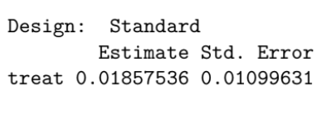
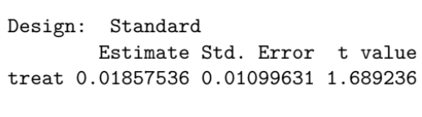
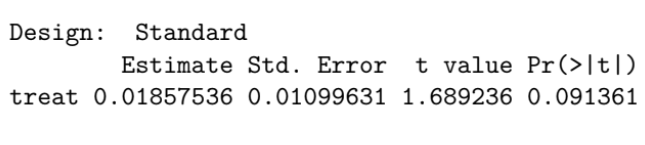
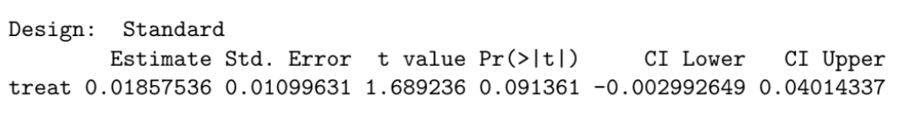

```{r setup, include=FALSE}
knitr::opts_chunk$set(echo = FALSE)
library(estimatr)

qr_image <- "images/qr-code-6.png"
```


## Agenda

1. Confidence Intervals
2. Heterogeneous Treatment Effects
3. Midterm Review

## Housekeeping

- Problem Set due 11:59 pm on Sunday
- Survey/data collection due October 23rd
- Midterm next week


## Confidence Intervals

A confidence interval is a range of possible values for the "true" population parameter

\vspace{1em}

Imagine we took a poll for Yes votes on the BART referendum.

**Sample estimate: 53%**

\textcolor{blue}{If you were a campaign manager for the BART referendum would you be confident you will win the election based on this data?}

\pause

**CI: [49%, 57%]**

\vspace{1em}

\textcolor{blue}{How about now? Do you still have the same opinion? Why or why not?}

## Building Confidence Intervals

- "Confidence" refers to the \textit{process} of making confidence intervals
    - If we made many intervals by taking many samples, 95% of the many intervals we create will "capture" the population parameter
\vspace{1em}
- Top of CI = Estimate + (1.96 $\times$ Standard Error)
- Bottom of CI = Estimate $-$ (1.96 $\times$ Standard Error)

## Interpreting Confidence Intervals

Another way of saying this:

- If we were to do an experiment over and over again and calculate a 95% confidence interval for each study we run, 95% of those confidence intervals would contain the true average treatment effect.
\vspace{1em}
- There is a 95% chance of our confidence interval including the true average treatment effect.

## Putting Confidence Intervals in Context

- You can think of the top of the confidence interval as our most optimistic guess about the size of the treatment effect, and the bottom of the confidence interval as our most pessimistic guess.
\vspace{1em}
- If the CI contains zero (or whatever the null hypothesis is), our findings are not statistically significant.
\vspace{1em}
- Because our CIs are a function of our estimates and their corresponding standard errors, these elements affect how wide our CIs are and around which value they are centered
        
## Putting Confidence Intervals in Context

\begin{itemize}
\item<1-> \textcolor{blue}{How do our confidence intervals change if the standard error changes?}
  \begin{itemize}
  \item<2-> As SE increases, the CI gets wider; as SE decreases, the CI gets narrower
  \end{itemize}
\item<1-> \textcolor{blue}{How do our confidence intervals change if the estimate changes?}
  \begin{itemize}
  \item<3-> This is the center of the CI and has nothing to do with the width (unless the standard error also changes).
  \item<3-> Ex: if your estimated effect was originally 5 and then doubled to 10, the new center of the CI would be 10, but its width would stay the same.
  \end{itemize}
\end{itemize}

## Interpreting P-Values and CIs

```{r, echo=TRUE, include=params$data_ok, eval=params$data_ok, size="footnotesize"}
fit <- difference_in_means(outcome ~ treat, data = dat)  # edit variable names
tidy(fit)[, c("term", "estimate", "std.error")]
```

```{r, eval=!params$data_ok, out.width="0.6\\textwidth", fig.align="center"}

```

- \textcolor{blue}{Interpret the estimate}
- \textcolor{blue}{Given the estimate and standard error, what can you predict about the significance of this estimate?}
\pause
- Example interpretation: Assuming the treatment was randomly assigned, it is our best guess that the treatment increased the outcome by around 1.86 percentage-points.

## Interpreting P-Values and CIs

```{r, echo=TRUE, include=params$data_ok, eval=params$data_ok, size="footnotesize"}
tidy(fit)[, c("term", "estimate", "std.error", "statistic")]
```

```{r, eval=!params$data_ok, out.width="0.75\\textwidth", fig.align="center"}

```

- \textcolor{blue}{Interpret the t-statistic.}
\pause
- Example interpretation: Because the t-value is less than 1.96, the observed effect is not statistically significant, and we cannot reject the null hypothesis.

## Interpreting P-Values and CIs

```{r, echo=TRUE, include=params$data_ok, eval=params$data_ok, size="footnotesize"}
tidy(fit)[, c("term", "estimate", "std.error", "statistic", "p.value")]
```

```{r, eval=!params$data_ok, out.width="0.9\\textwidth", fig.align="center"}

```

- \textcolor{blue}{Interpret the p-value}
\pause
- If we were to run this experiment over and over and the treatment had no effect, we would expect to see an estimate this size or larger around 9% of the time. Though our best guess is that the treatment is increasing the outcome, we cannot reject the null hypothesis given that the p-value is greater than 0.05.

## Interpreting P-Values and CIs

```{r, echo=TRUE, include=params$data_ok, eval=params$data_ok, size="scriptsize"}
difference_in_means(outcome ~ treat, data = dat)
```

```{r, eval=!params$data_ok, out.width="\\textwidth", fig.align="center"}

```

\small

- \textcolor{blue}{What do the confidence intervals tell us about the likely range of true average treatment effects?}
\pause
- If we were to repeat this experiment many times and construct a 95% confidence interval each time, approximately 95% of those intervals would contain the true average treatment effect.
- We are 95% confident that the true average treatment effect is between -0.003 and 0.040.
- The treatment is unlikely to have decreased the outcome by more than 0.3 percentage-points.
- The treatment is unlikely to have increased the outcome by more than 4 percentage-points.


```{r attendance, results='asis', echo=FALSE}
if (params$show_answers) {
  cat(paste0("
## Attendance Survey
\\begin{center}
\\includegraphics[width=0.7\\textwidth]{", qr_image, "}
\\end{center}
"))
}
```


## Heterogeneous Treatment Effects

- "Heterogeneous" = different
    - vs the word "homogeneous" = same
- The general idea:
    - A treatment could have different effects on different groups in terms of magnitude (size of effect)

\vspace{1em}
\small

| Group | Love for Oski before seeing photo | Love for Oski after seeing photo | Difference (after - before) |
|:--|:-:|:-:|:-:|
| Berkeley students | 75% | 100% | +25% |
| Stanford students | 70% | 80% | +10% |

## How to calculate HTEs in R

```{r, echo=TRUE, eval=FALSE}
# Step 1: subset the main dataset to the
# group you want to focus on
cal_students <- subset(data, school == "UCB")

# Step 2: calculate the difference in means on the subset,
# NOT the full dataset
difference_in_means(oski_love ~ saw_photo, cal_students,
                    condition1 = 0, condition2 = 1)
```

## HTEs: Interpretations and Limitations

\small

- Calculating an average treatment effect within a subset/group tells you the average treatment effect within that group
    - i.e. how seeing the picture vs. not seeing the picture affects Berkeley students
\pause
- Why can't we say being a Berkeley student instead of a Stanford student causes someone to be more pro-Oski?
    - We don't randomly assign Berkeley vs. Stanford
    - Remember: Causal statements pertain to what we can randomize
    - We can randomize the treatment, but not the characteristics that we choose to base our subsets on
\pause
- HTEs just tell us how the treatment effect varies within groups -- they don't suggest that group characteristics cause anything in our outcome


## Acknowledgements

Special thanks to prior GSIs for providing materials off of which some of these slides are based, especially Will Halm.
